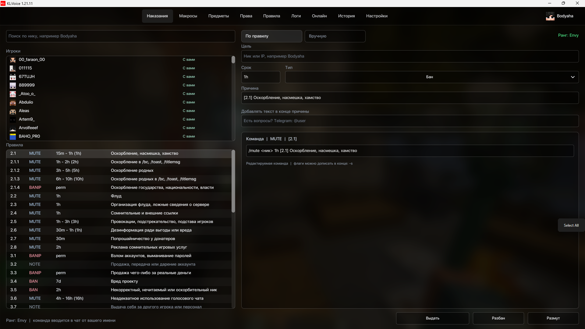
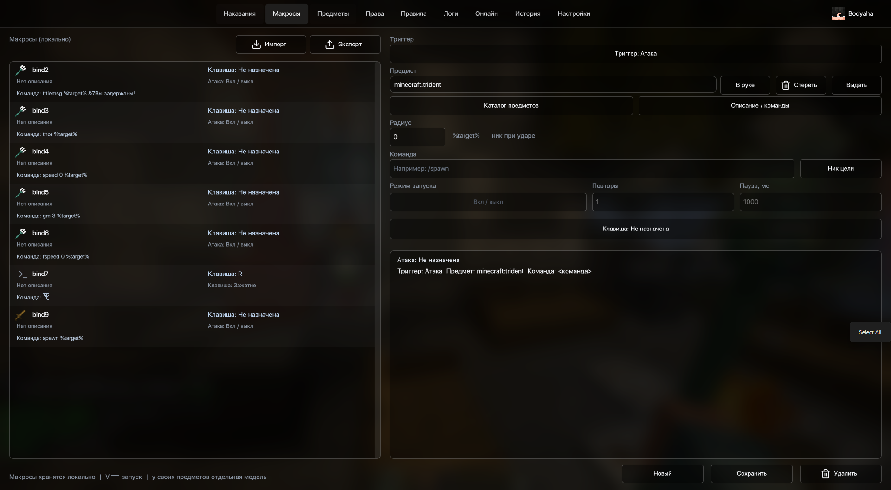
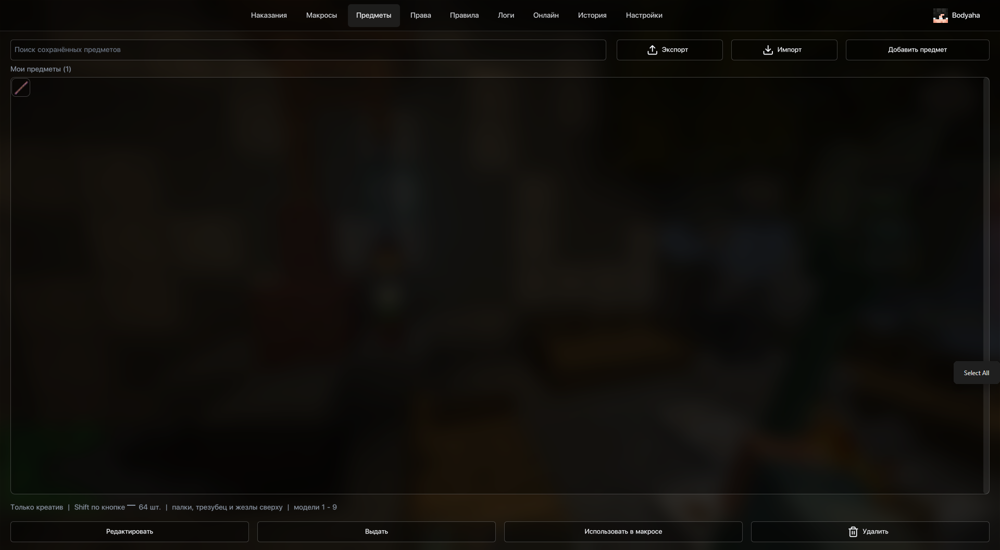
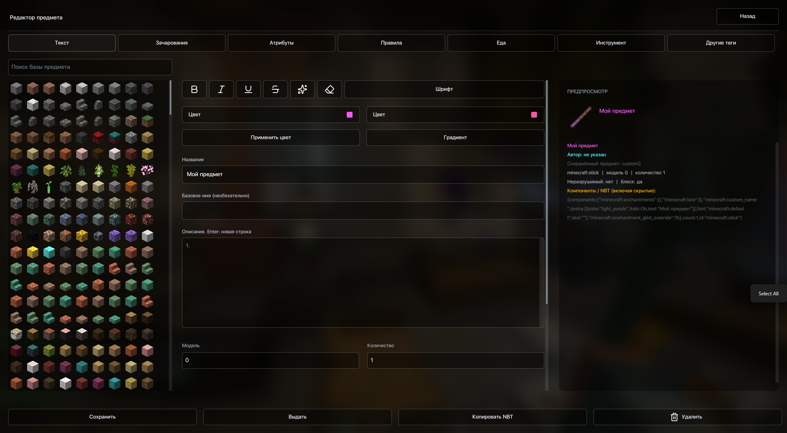
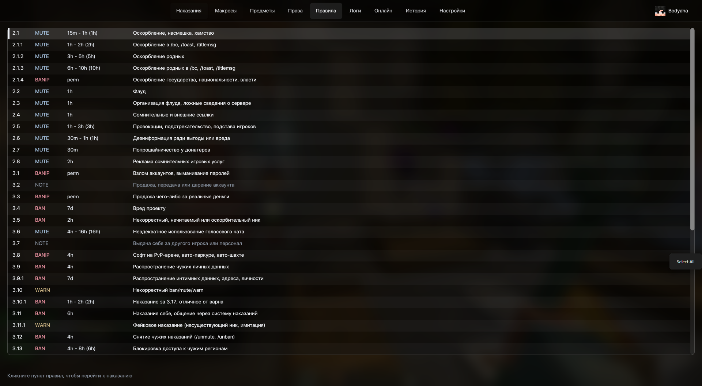
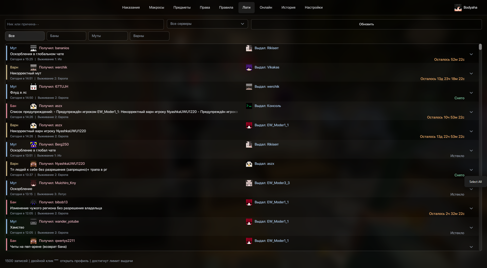
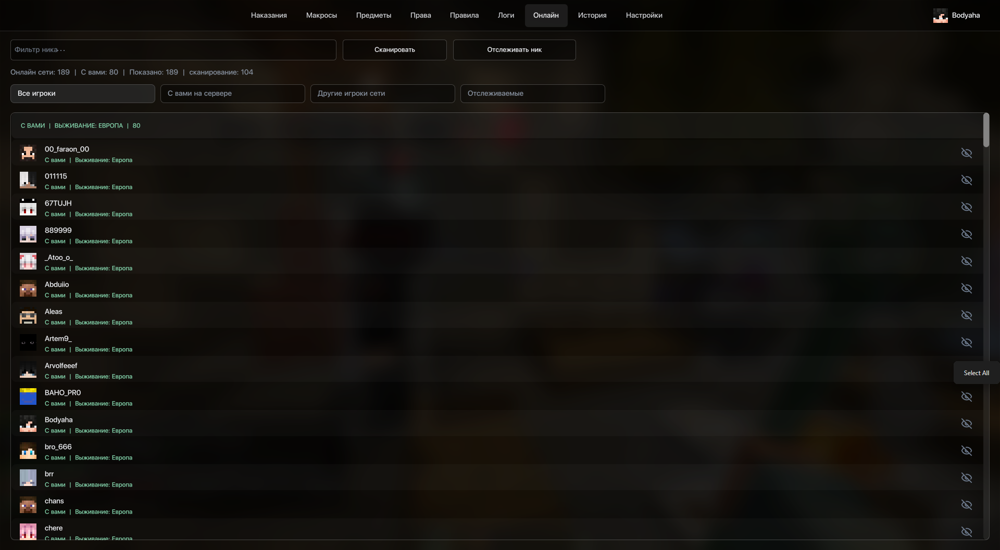
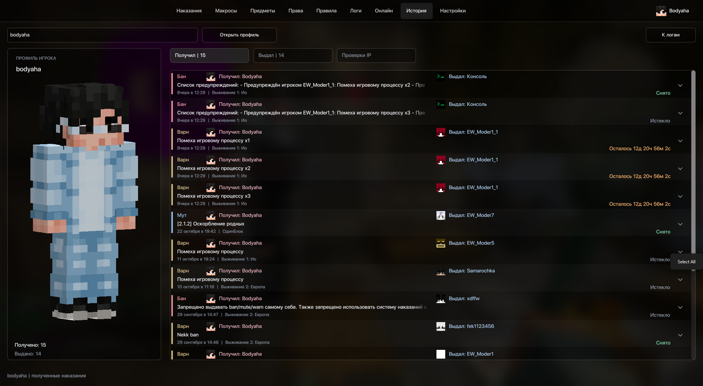

# Envyworld Panel

Моя клиентская панель для сервера **play.envyworld.gg**, сделанная под **KLVoice в KLauncher**. Я собрал в одном меню наказания, правила, макросы, предметы, логи и инструменты наблюдателя — чтобы не держать все команды в голове и не переключаться постоянно между игрой и сайтом.

Мод работает на **Minecraft 1.21.11, Fabric**. На сервер его устанавливать не нужно. Команды выполняются от имени игрока с его обычными правами.



## Что есть в панели

- **Наказания.** Выбор игрока, пресеты правил, срок, причина и предпросмотр команды перед отправкой. Отдельные действия для снятия наказаний.
- **Макросы.** Команды на атаку, использование предмета или свою клавишу; выбор цели по взгляду и в радиусе; несколько команд с задержками и повторами. Фильтр предмета действует и для отдельного бинда.
- **Предметы.** Каталог Minecraft и редактор своих предметов: название, описание, зачарования, атрибуты, модель и другие компоненты. Можно связать предмет с макросом и обмениваться коллекциями через JSON. Выдача предметов требует креатива.
- **Права и правила.** Список привилегий и команд по режимам, поиск по правилам и подстановка выбранного пункта в наказание.
- **Логи и профили.** Поиск наказаний, фильтры по типу и серверу, подробности записи, скины и история игрока.
- **Онлайн.** Список игроков и отслеживание выбранных ников с уведомлениями о входе и выходе.
- **Наблюдатель.** Рамки, ники, здоровье, экипировка и действующие наказания над игроками. Проверки связанных аккаунтов доступны только в GM 3.
- **HUD.** Перемещение и масштабирование блоков, сетка, привязки, прозрачность и размытие. Уведомления о запуске IP-проверок отдельно не всплывают.
- **Telegram.** Подключение личного бота, уведомления, чат и Mini App для просмотра и управления запущенным клиентом.
- **Защита клиента.** Ограничение всплесков частиц, звуков и отрисовки, отслеживание зависаний с настраиваемым отключением.

## Установка

1. В KLauncher выберите **KLVoice для Minecraft 1.21.11**.
2. Скачайте [`envyworld-1.0.0.jar`](https://github.com/Bodyaha-Sobolev/Envyworld-Panel/releases/latest/download/envyworld-1.0.0.jar) из [релизов](https://github.com/Bodyaha-Sobolev/Envyworld-Panel/releases/latest).
3. Закройте игру и положите JAR в папку `mods` профиля **KLVoice**. При обновлении замените предыдущий JAR мода.
4. Запустите KLVoice и зайдите на **play.envyworld.gg**. Меню открывается правым **Shift**, общая клавиша предметных макросов — **V**.

Сборка рассчитана на **Minecraft 1.21.11**, **Fabric Loader 0.19.5** и **Fabric API 0.141.6+1.21.11**. Fabric API должен быть установлен в том же профиле.

Клавиши можно переназначить в управлении Minecraft. Для проверки аккаунтов и открытия профиля цели предусмотрены отдельные бинды; по умолчанию они не назначены.

## Как устроены проверки аккаунтов

Проверка запускается по выбранному игроку в режиме наблюдателя. `/dupeip` показывает связанные ники, а `/iphistory` позволяет последовательно проверить уникальные адреса из истории. Следующий запрос отправляется после ответа: с интервалом 250 мс, при количестве адресов больше 10 — 500 мс. Отказ сервера, ограничение или отсутствие ответа останавливают очередь.

Над игроком показываются только связанные аккаунты: его собственный ник и основная карточка наказания не дублируются. Ники складываются в строки по доступной ширине, до семи в строке. Рядом с ником видны актуальные отметки: «Мут», «Бан», «Бан по IP» или «Предупреждение».

Цвета ответа сервера сохраняются: оранжевый — мут, светло-красный — бан, тёмно-красный — блокировка по IP. Причины действующих наказаний берутся из логов. Полная история доступна в профиле. Совпадение IP само по себе не означает, что аккаунты принадлежат одному человеку.

Привилегия на выживании определяется по отдельному полю scoreboard. Если таблица отключена, мод запрашивает её через `/sb`. Ручная команда `/sb` или `/scoreboard` переключает её видимость локально: данные продолжают приходить.

## Макросы

Для макроса можно выбрать обычный предмет, сохранённый пресет или «любой предмет». Если задан конкретный предмет, он должен быть в основной руке при запуске и во время повторов. Переключение на другой предмет останавливает такой макрос.

Режимы запуска: нажатие, удержание и переключатель. В последовательности можно настроить задержку каждой команды. Импортированные макросы не получают чужие горячие клавиши автоматически — их нужно назначить у себя.

В командах поддерживаются подстановки `%player%`, `%player_uuid%`, `%target%`, `%target_uuid%`, `%target_health%`, `%item%`, `%world%`, `%x%`, `%y%`, `%z%`. Доступность цели зависит от выбранного триггера.

## Telegram и данные

Подключение находится в настройках панели. Создайте своего бота через BotFather, введите токен в игре и подтвердите подключение через Start. Панель привязывается к владельцу, а Mini App проверяет подпись и срок действия Telegram-сессии.

Локальные файлы находятся в `config/envyworld/`. Общие настройки, макросы и предметы хранятся в `config.json`; параметры бота — отдельно в `telegram-private.json`. Эти файлы не входят в репозиторий.

Мод обращается к API Envyworld за логами и онлайном, к сервисам скинов и к Telegram при подключённом боте. Mini App создаёт локальный HTTP-сервер и внешний туннель; эта часть сейчас рассчитана на **Windows x64**. Она работает, пока запущена игра. Подробнее — в [описании устройства проекта](docs/ARCHITECTURE.md).

## Сборка и проверки

Для сборки используйте **JDK 25 или 26**. Java-код компилируется с целевой версией **21**. Проект использует Gradle Wrapper; версии Minecraft и зависимостей указаны в `gradle.properties` и `build.gradle`.

Windows:

```powershell
.\gradlew.bat build
```

Linux / macOS:

```sh
./gradlew build
```

`build` запускает проверки логов, макросов, определения ранга, уведомлений, профилей и соответствия предметов. Отдельно можно выполнить:

```powershell
.\gradlew.bat logCacheSmokeTest catalogItemSmoke
.\gradlew.bat renderSmokeTest
python tools/audit_release.py
```

Проверка рендера требует доступного OpenGL-контекста. В `tools/CleanUiProbe.java` оставлен сценарий ручной проверки меню и HUD в отдельном тестовом клиенте; в релизный JAR он не включается.

## Структура

```text
Envyworld-Panel/
├── src/main/java/com/envyworld/
│   ├── bind/          # описание макросов и триггеров
│   ├── client/        # клиент, клавиши, scoreboard, защита и удалённая панель
│   │   └── gui/       # меню, редакторы, HUD и таблички над игроками
│   ├── graphics/      # рендер, шрифты, размытие и OpenGL-ресурсы
│   ├── items/         # предметы, компоненты, пресеты и обмен коллекциями
│   ├── logs/          # логи, уведомления, онлайн, сессия и Telegram
│   ├── mixin/         # точки интеграции с Minecraft
│   ├── ranks/         # каталог привилегий и определение своего ранга
│   ├── rules/         # правила и пресеты наказаний
│   ├── config/        # настройки и сохранение JSON
│   ├── command/       # локальные команды встроенного сервера
│   ├── punish/        # локальное хранилище наказаний
│   └── util/          # общие вспомогательные классы
├── src/main/resources/
│   └── assets/envyworld/
│       ├── renderer/  # шейдеры и атласы шрифтов
│       ├── nametags/  # шрифт табличек игроков
│       ├── remote/    # интерфейс Mini App
│       ├── ui/        # иконки интерфейса
│       └── sounds/    # звуки уведомлений
├── tools/             # проверки и аудит сборки
├── docs/              # устройство и полное дерево проекта
├── licenses/          # уведомления для сторонних компонентов
├── gradle/            # Gradle Wrapper
└── build.gradle
```

Полное дерево файлов — [PROJECT_TREE.md](docs/PROJECT_TREE.md). Связи между модулями и основные сценарии — [ARCHITECTURE.md](docs/ARCHITECTURE.md).


## Скриншоты

<details>
<summary>Макросы</summary>



</details>

<details>
<summary>Свои предметы</summary>



</details>

<details>
<summary>Редактор предмета</summary>



</details>

<details>
<summary>Правила</summary>



</details>

<details>
<summary>Логи наказаний</summary>



</details>

<details>
<summary>Онлайн сервера</summary>



</details>

<details>
<summary>История и профиль игрока</summary>



</details>

## Обратная связь

Баги и предложения можно оставить в [Issues](https://github.com/Bodyaha-Sobolev/Envyworld-Panel/issues). Для ошибки полезны версия игры и мода, короткие шаги воспроизведения и скриншот. Перед отправкой логов уберите токены, личные адреса и другие приватные данные.

## Лицензия

Основной код распространяется по [CC0-1.0](LICENSE). Отдельные графические компоненты и ресурсы сохраняют свои условия; уведомления перечислены в [THIRD_PARTY_NOTICES.md](THIRD_PARTY_NOTICES.md).
